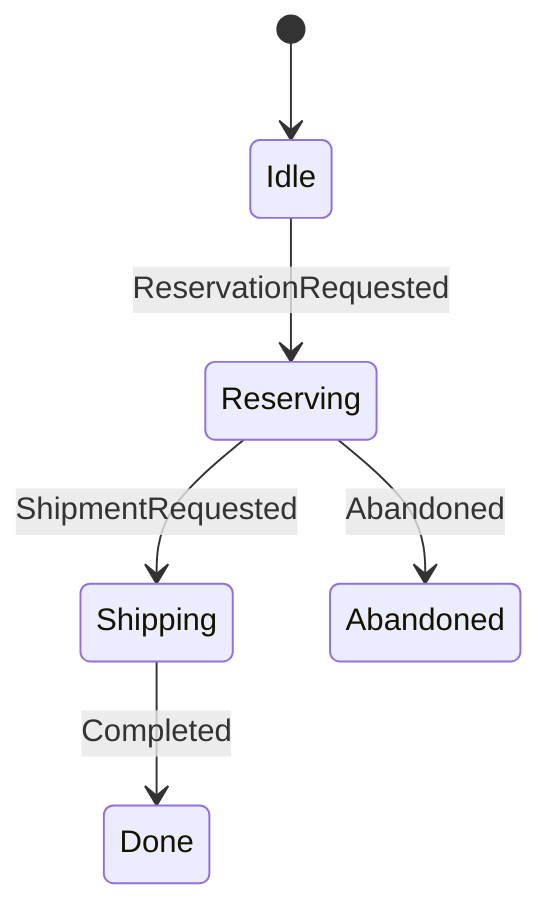
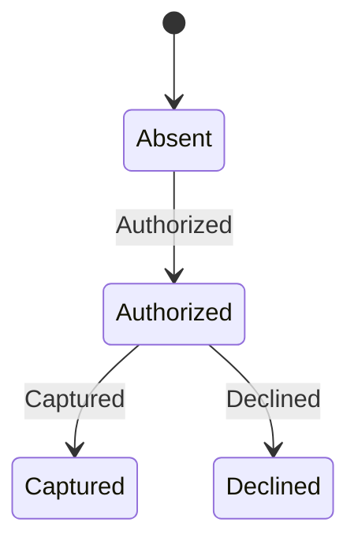
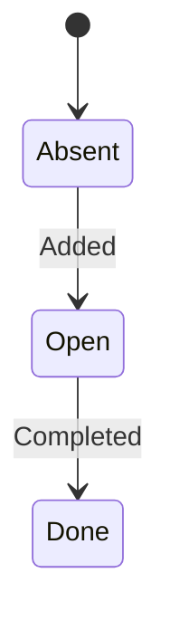

# State machines

Generated by `just views` from each lifecycle's `evolve`. An arm that returns the state it was
given is not drawn.

## Fulfilment

`domain/src/fulfilment.rs`

## Payment

`domain/src/payment.rs`

## Task

`domain/src/task.rs`

